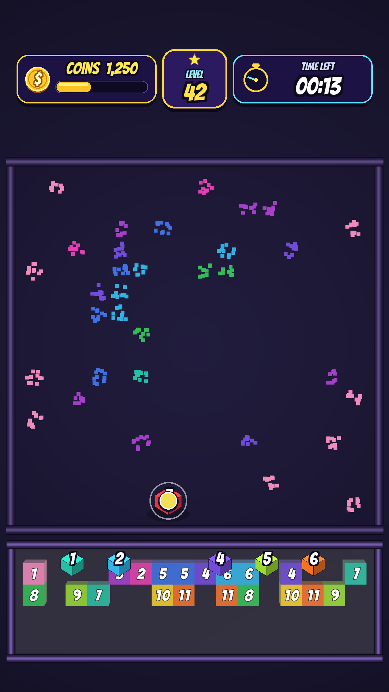
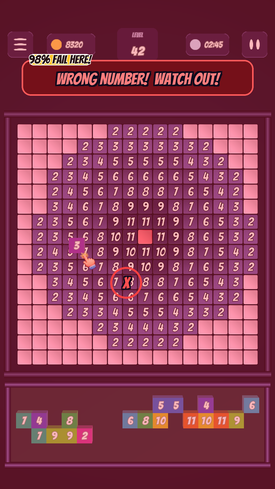
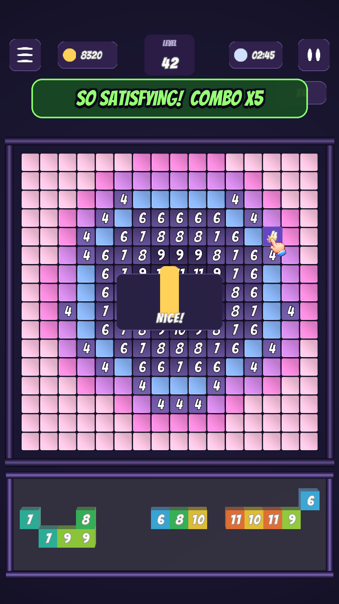
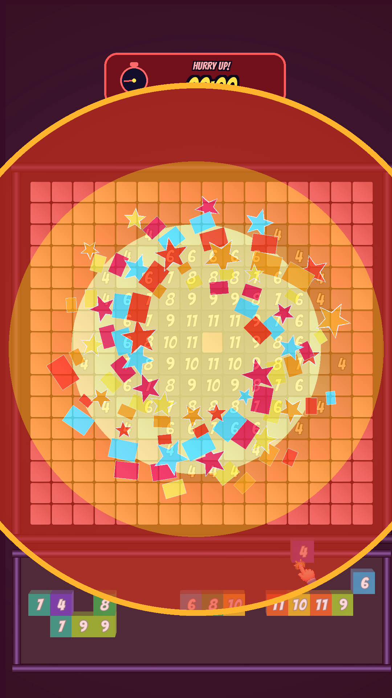
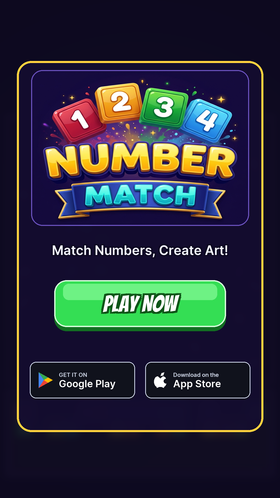

# Number Match — 3D Pixel Art Puzzle & Creative Ad Case Study

A 3D colour-by-number mobile puzzle game built in **Unity 6 (URP)** by **Melisa Tuğçe Haspolat**, complete with a 9:16 vertical **Marketing Creative Video** produced with **Adobe After Effects**, **Adobe Illustrator**, and **Higgsfield AI**, plus a **Playable Ad** version in the [Playable Ads Portfolio](https://github.com/tugcemelisa/playable-ads-portfolio).

---

## Creative Video & Links

- **Creative Video (MP4 in Repo):** [`CreativeAd_AfterEffects/NumberMatch_Creative_Video_Final.mp4`](CreativeAd_AfterEffects/NumberMatch_Creative_Video_Final.mp4)
- **Raw Gameplay Capture (1080×1920, 30 FPS):** [`CreativeAd_AfterEffects/NumberMatch_Raw_Gameplay.mp4`](CreativeAd_AfterEffects/NumberMatch_Raw_Gameplay.mp4)
- **YouTube Shorts Link:** [Watch on YouTube Shorts](https://youtube.com/shorts/G4jU1Z6JKeI)
- **Live Playable Ad Demo (Unity Playworks HTML5):** [Play Number Match in Browser](https://tugcemelisa.github.io/playable-ads-portfolio/number-match/)
- **Playable Ads Portfolio Repository:** [https://github.com/tugcemelisa/playable-ads-portfolio](https://github.com/tugcemelisa/playable-ads-portfolio)

---

## Creative Video Storyboard (9:16 Vertical — 1080×1920)

| Hook / Beat | Timestamp | Visual & Audio Breakdown |
|---|---|---|
| **1. Dynamic Top HUD & Opening Hook** | `0.0s – 3.0s` | Custom animated top HUD featuring a live **COINS (`1,250 → 2,500`)** reward bar, **LEVEL 42** royal crest, and a ticking **TIME LEFT (`00:14 → 00:00`)** stopwatch (kept 100% visible throughout). On the first move (`1.53s`), the player drops a tile onto the wrong number cell — triggering an instant error buzzer SFX, screen shake, red danger flash, and a center-screen **Sad Emoji (😢) + `"WRONG NUMBER! WATCH OUT!"`** modal (no reward particles on failure). |
| **2. Radial Wave Reveals & Star-Eyes Praise** | `3.0s – 13.6s` | Deliberate, readable drag-and-drop gameplay completes four colour rings one by one. Each completed group shatters open with a 360° radial wave dissolve (`RevealEffects`) while a center-screen **Star-Struck Emoji (🤩) + `"AMAZING! PERFECT MATCH!"` / `"BRILLIANT! GENIUS MOVE!"`** praise card pops up with star/confetti celebration particles and ascending chimes. |
| **3. Centered Countdown Alarm & `00:00` Explosion Transition** | `9.0s – 14.3s` | As the timer reaches `00:05`, the HUD cards hide to place a bold, centered red **`"HURRY UP!"`** countdown timer in the middle of the screen. Accelerating clock tick-tock and alarm beeps build tension until `00:00` (`13.68s`), when a massive 3D fireball & shockwave explosion with 85 flying 3D debris blocks and stars blasts open directly into the Endcard. |
| **4. 3D Endcard & Voiceover CTA** | `14.0s – 18.0s` | Features the 3D **NUMBER MATCH** logo and motion graphics composited and animated in **Adobe After Effects**, with vector store badges, UI elements, and typography designed in **Adobe Illustrator**, the slogan ***"Match Numbers, Create Art!"***, a pulsing 3D green **PLAY NOW** CTA button leading to the App Store, and an energetic female voiceover announcement: ***"Play Number Match Now!"***. |

### Keyframe Previews

  
  
  
  
  

---

## Core Game Architecture (Unity 6 URP)

- **GPU-Instanced 3D Board (`BoardRenderer.cs` & `PixelPaintGrid.cs`):** Renders the bevelled 3D grid cells and number atlas via procedural GPU instancing with per-cell spring physics, red error flash, and radial group wave dissolve.
- **Tactile Drag & Drop (`DragDropController.cs` & `PaintPiece.cs`):** Smooth arc lifting, socket snapping, voronoi crack-fragment shattering (`CrackFragments.cs`), and bounce-back rejection on wrong cells.
- **Procedural Audio & Cinemachine Feedback (`ProceduralSfx.cs` & `RevealEffects.cs`):** Runtime-synthesized pickup, reject, placement, and chord chime audio paired with particle bursts and camera impulses.
- **Automated 9:16 Creative Capture (`CreativeVideoDirector.cs`):** Choreographs deterministic gameplay hooks and exports frame-accurate `1080×1920` PNG sequences + millisecond-synced SFX event logs for the After Effects (`Build_NumberMatch_Creative_AE.jsx`) & Higgsfield compositing pipeline.
